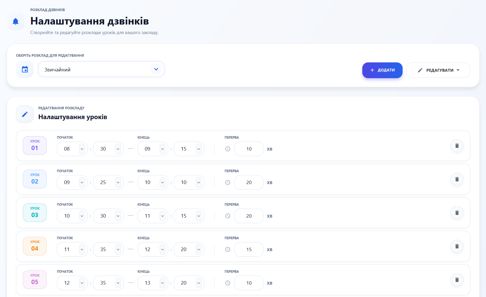
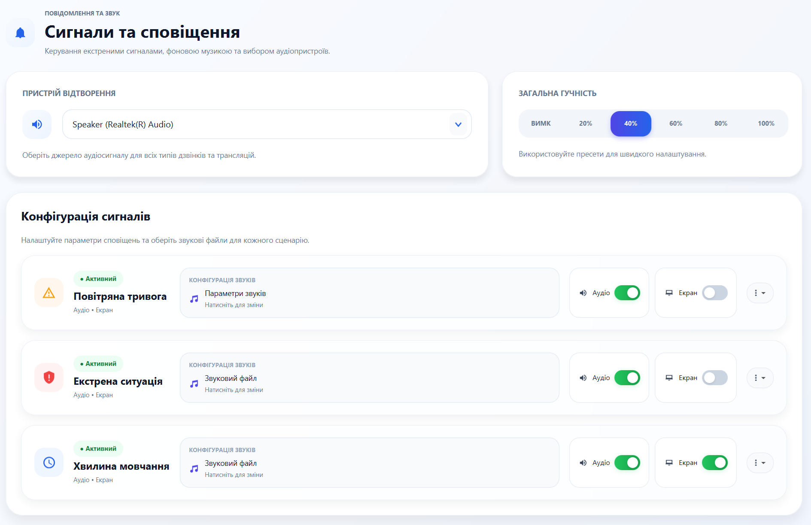
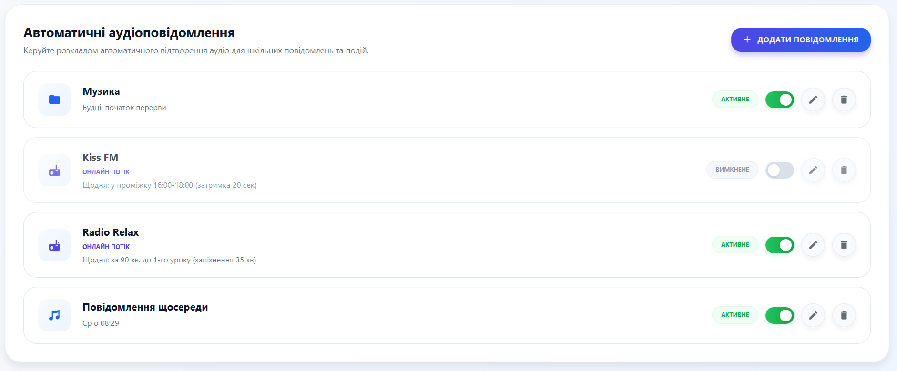
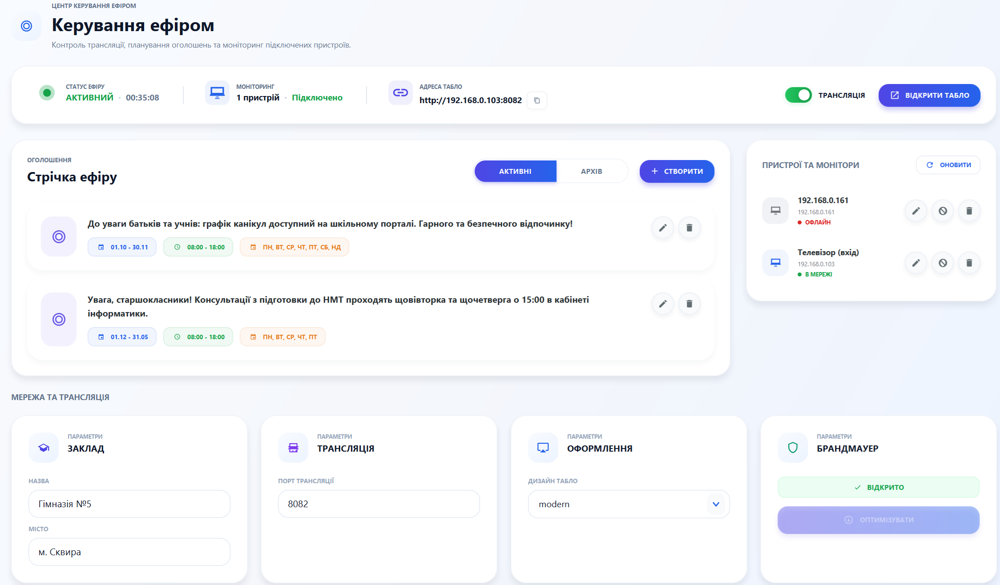
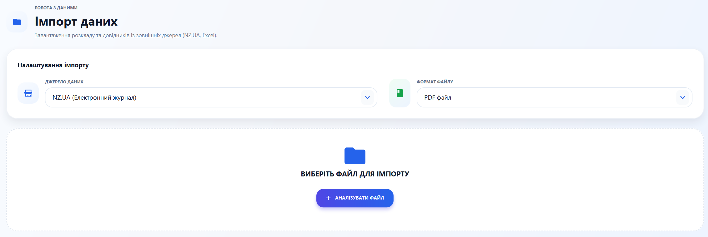
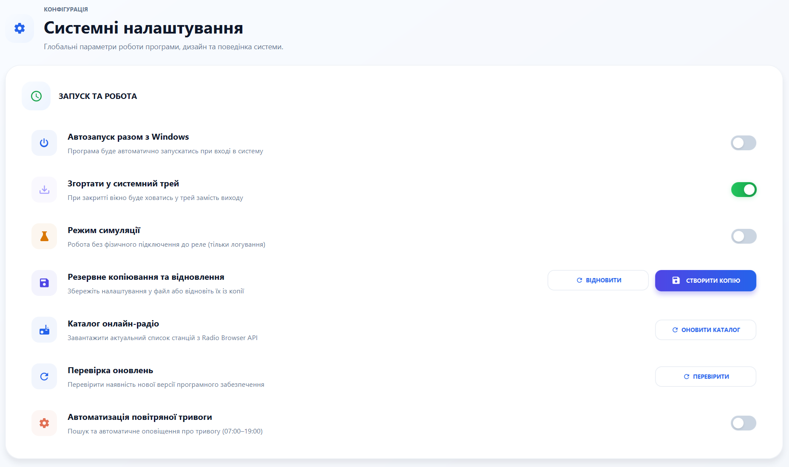

# School Bell — Автоматизована система шкільних дзвінків

## 📖 Історія проекту

Цей проект народився не просто як програмне забезпечення, а як рішення реальної проблеми в українській школі під час війни.

Мій батько працює вчителем фізики. Він завжди прагнув до автоматизації та інновацій, тому спочатку намагався налаштувати систему шкільних дзвінків через розумні реле Sonoff. Це працювало, але реальність внесла свої корективи. Повітряні тривоги, постійні перегляди розкладів через відключення світла та необхідність оперативно змінювати час уроків зробили використання звичайних IoT-рішень занадто складним. Систему доводилося постійно вимикати, і вчителям знову доводилося давати дзвінки вручну.

Тоді ми вирішили створити **School Bell** — спеціалізовану програму, яка дозволяє гнучко керувати розкладом уроків та автоматично подавати дзвінки через реле, підключене до комп'ютера. Навіть у найскладніші часи технології мають допомагати освіті залишатися організованою.

## 🚀 Основні можливості

### 🔔 Керування дзвінками та розкладом
- **Гнучкі розклади:** Створення декількох варіантів розкладу (основний, скорочений, святковий, індивідуальні графіки дзвінків для окремих днів).
- **Підтримка дротових і бездротових реле:** 
  - Пряме підключення через **USB-реле (HID)** без необхідності встановлення сторонніх драйверів.
  - Бездротове керування через Wi-Fi реле **Shelly (Gen1, Gen2, Gen3)** у локальній мережі.
- **Точність до секунди:** Вбудована синхронізація часу через NTP-сервери унеможливлює розсинхронізацію через системний годинник комп'ютера.
- **Заміни вчителів:** Зручний облік щоденних замін уроків без порушення базової сітки розкладу.

### 🛡️ Безпека та повітряні тривоги
- **Автоматичний моніторинг тривог:** Миттєве отримання сигналів небезпеки у вашому регіоні через офіційне API.
- **Гнучке сповіщення:**
  - Через шкільний дзвінок (спеціальний патерн із коротких сигналів та пауз).
  - Через аудіосистему школи з розподілом аудіофайлів за статусом (тривога / відбій) та рівнями небезпеки (жовтий / червоний).
- **Захист навчального процесу:** Автоматичне блокування стандартних розкладних дзвінків під час дії повітряної тривоги.

### 📻 Шкільний медіаефір та радіо
- **Музичні перерви:** Автоматичне увімкнення музики, плейлистів або онлайн-радіостанцій на перервах, до початку або після закінчення уроків.
- **Акустичний комфорт:** Вбудоване плавне згасання звуку (fade-out) перед подачею дзвінка, щоб аудіопотік не обривався різко.
- **Інтеграція зі шкільною мережею:** Легке підключення до наявної акустичної системи школи або радіовузла.

### 📺 Інформаційне веб-табло (Digital Signage)
- **Трансляція на Smart-TV та монітори:** Відображення поточної таблиці уроків і зворотного відліку часу до дзвінка на будь-якому телевізорі чи екрані в локальній мережі (через вбудований браузер ТВ на порту **9090**, без потреби встановлювати сторонні програми).
- **Шкільні оголошення:** Публікація важливих текстових повідомлень прямо на екрані розкладу.

### 📥 Імпорт та база даних школи
- **Розумний імпорт із PDF:** Автоматичне розпізнавання та заповнення розкладу, вчителів, класів і аудиторій із завантажених PDF-файлів (зокрема експортованих з платформи **NZ.UA / «Нові Знання»**).
- **Єдина база школи:** Збереження структури класів, аудиторій, предметів і викладачів у локальній базі даних SQLite.
- **Резервне копіювання:** Створення та відновлення резервних копій бази в один клік.

### ⚙️ Комфорт та зручність
- **Фонова робота:** Автозапуск разом із Windows, згортання в системний трей і надійна робота у фоні.
- **Сучасний інтерфейс:** Приємний візуальний стиль **"Modern Academic Soft UI"**, розроблений для швидкого освоєння та комфортної щоденної роботи.
- **Журнал подій:** Детальний аудит дій та спрацьовувань системи для аналізу роботи дзвінків і реле.
- **Автоматичне оновлення:** Швидке отримання оновлень програми без втрати користувацьких даних і налаштувань.

## 📖 Документація та інструкції

Для швидкого ознайомлення з усіма функціями програми скористайтеся нашим детальним посібником:

👉 [**Читати повну інструкцію користувача**](instructions/ПОСІБНИК_КОРИСТУВАЧА.md)

Там ви знайдете відповіді на питання щодо налаштування розкладів, підключення реле, автоматизації тривог та багато іншого.

## 💻 Системні вимоги

- **Операційна система:** Windows 10 або Windows 11 (64-bit).
- **Процесор:** Intel Core i3 / AMD Ryzen 3 або аналогічний.
- **Оперативна пам'ять:** від 4 ГБ.
- **Вільне місце на диску:** ~300 МБ.
- **Порти:** 1 вільний USB-порт для підключення USB-реле.
- **Дисплей:** роздільна здатність від 1280x720.

## 🔌 Підтримуване обладнання

Програма підтримує два типи пристроїв для керування фізичним дзвінком: USB-реле (пряме підключення до ПК) та Wi-Fi-реле Shelly (керування через локальну мережу).

### 1. USB-реле (HID)

Працює як USB HID-пристрій та не потребує встановлення додаткових драйверів у Windows.

Для керування дзвінком USB-реле може бути встановлене в окремий прозорий блок із роз'ємом IEC C14, вимикачем, запобіжником і твердотільним реле SSR-40 AA. USB-реле приймає команди від програми, а SSR комутує силове коло дзвінка. Детальний опис схеми, клем SSR (1–4) та фотографії блока наведені в [розділі про електричну схему блока керування](instructions/sections/7_Система.md#usb-relay-control-box).

| Модель / Чіп | Опис | Статус |
| :--- | :--- | :---: |
| **USBRelay2** | VID_16C0 PID_05DF (2 канали) | ✅ Протестовано |
| **USBRelay1/4/8** | Моделі на 1, 4 або 8 каналів | ℹ️ Теоретично сумісно |
| **Сумісні USB HID-реле** | Пристрої на базі VID_16C0 / PID_05DF | ℹ️ Теоретично сумісно |

### 2. Wi-Fi-реле (Shelly)

Керування здійснюється через локальну мережу за допомогою HTTP RPC API.

| Покоління | Пристрої | Статус |
| :--- | :--- | :---: |
| **Gen3** | Shelly 1 Mini Gen3 та інші пристрої Gen3 | ✅ Протестовано |
| **Gen2** | Shelly Plus 1, Shelly Pro 1 та інші пристрої Gen2 | ℹ️ Теоретично сумісно |
| **Gen1** | Shelly 1, Shelly 1PM та інші пристрої Gen1 | ℹ️ Теоретично сумісно |

> **Рекомендація:** Для стабільної роботи Shelly рекомендується налаштувати постійну IP-адресу (DHCP Reservation) на роутері.

## 📦 Встановлення та дані користувача

Програма постачається у вигляді зручного інсталятора Windows:

1. **Встановлення:** Запустіть файл [SchoolBell_Setup_v1.2.9.exe](https://github.com/Asic95/school_bell/releases/download/v1.2.9/SchoolBell_Setup_v1.2.9.exe) та дотримуйтесь інструкцій (доступна українська мова).
2. **Дані користувача:** Програма зберігає всі ваші розклади та налаштування у папці `%APPDATA%\SchoolBell\`. Це означає, що при оновленні програми або її перевстановленні ваші дані **не будуть втрачені**.
3. **Резервні копії:** Рекомендуємо періодично використовувати функцію "Створити копію" у розділі "Система" для додаткової безпеки ваших даних.

## 💬 Зворотній зв'язок та оцінка

Ваша думка дуже важлива для розвитку проекту! Якщо ви скористалися **School Bell**, будь ласка, приділіть кілька хвилин, щоб поділитися своїми враженнями:

👉 [**Заповнити форму зворотнього зв'язку та оцінити продукт**](https://docs.google.com/forms/d/e/1FAIpQLSeLFzzs3mN4KEXgnWyLBzWTqvZ19ZMhobZqEDKHOAVV3eHJjQ/viewform?usp=header)

Ви можете залишити відгук, повідомити про проблеми або запропонувати нові ідеї для покращення системи.

## 🛠 Технології

- **Мова:** Java 21 (JavaFX)
- **База даних:** SQLite
- **Збірка та пакування:** Maven, jpackage, Inno Setup
- **Логування:** SLF4J

## ⚖️ Ліцензія

Цей проект поширюється під ліцензією **GNU GPL v3**. Ви можете вільно використовувати та поширювати цю програму у своїй школі. Використання у комерційних закритих проектах заборонено.

---
**Автор:** Андрій Большаков (Andrii Bolshakov)  
**Рік:** 2026
