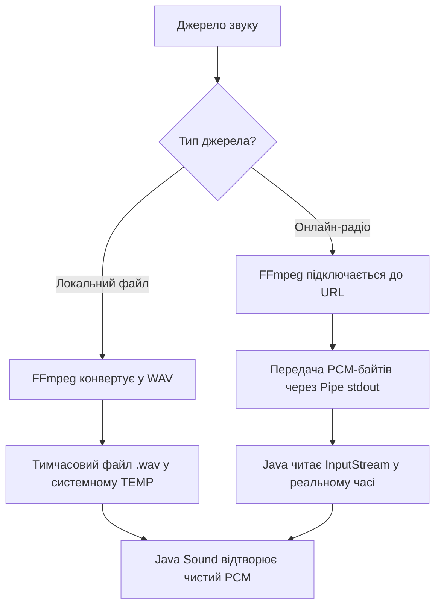

# Стратегія переходу на FFmpeg Аудіо-рушій у School Bell

Цей документ містить детальний технічний план переходу з нестабільного Java Sound SPI (JLayer, JAAD) на надійне декодування через **FFmpeg** для локальних файлів та онлайн-радіо.

---

## 1. Чому поточне рішення потребує заміни?
Поточна реалізація в [AudioService.java](file:///C:/school_bell/untitled/src/main/java/com/schoolbell/service/AudioService.java) використовує бібліотеки декодування `jlayer` (для MP3) та `javasound-aac` (для AAC/M4A). Вони мають суттєві обмеження:
1. **Застарілість**: `jlayer` не підтримує багато сучасних MP3-профілів та стиснення VBR.
2. **Збої на AAC**: Рідкісні профілі (AAC SSR, HE-AAC) або пошкоджені файли викликають білий шум або помилки `Resetting to invalid mark`.
3. **Нестабільність потоків радіо**: Стандартні Java-підключення не вміють обробляти ICY-метадані радіостанцій, редіректи та нестабільні SSL-сертифікати.

---

## 2. Архітектура нового FFmpeg-рушія

Нове рішення розділяє джерела звуку на два типи: **локальні файли** та **мережеві потоки**. Обидва обробляються через FFmpeg, але за різними принципами.



### А. Локальні файли (Попереднє транскодування)
Перед відтворенням пісня повністю перекодовується у тимчасовий `.wav` файл.
* **Чому**: Це виключає будь-яке керування фоновими процесами під час дзвінка. Файл декодується миттєво (за 50–100 мс).
* **Формат виводу**: Стандартний PCM WAV (`16-bit, 44.1kHz, Stereo`).
* **Відтворення**: Програється за допомогою нативного Java Sound API без сторонніх SPI-плагінів. Після завершення файл видаляється.

### Б. Онлайн-радіо (Piping / Потокове декодування)
Оскільки радіо є нескінченним, воно декодується «на льоту» та передається в Java через потік введення-виведення (Pipe).
* **Чому**: Запобігає накопиченню гігабайт сміття на диску.
* **Як працює**: FFmpeg запускається як підпроцес, який декодує стрім і пише сирі PCM-байти в свій `stdout`. Java зчитує ці байти через `process.getInputStream()` і відразу відправляє в аудіокарту.
* **Зупинка**: Зупинка радіо здійснюється через примусове вбивство процесу FFmpeg (`process.destroyForcibly()`).

---

## 3. Покроковий план впровадження

### Крок 1: Оновлення [pom.xml](file:///C:/school_bell/untitled/pom.xml)
Необхідно прибрати старі SPI-бібліотеки і додати кросплатформну обгортку для FFmpeg. Найкращий вибір — **JAVE2** (Java Audio Video Encoder), яка автоматично постачає потрібні бінарники FFmpeg під Windows, Linux та macOS.

Видаляємо:
* `jlayer`
* `mp3spi`
* `tritonus-share`
* `javasound-aac`

Додаємо:
```xml
<!-- FFmpeg wrapper for Java -->
<dependency>
    <groupId>ws.schild</groupId>
    <artifactId>jave-core</artifactId>
    <version>3.3.1</version>
</dependency>
<!-- Native binaries for Windows and Linux -->
<dependency>
    <groupId>ws.schild</groupId>
    <artifactId>jave-nativebin-win64</artifactId>
    <version>3.3.1</version>
</dependency>
<dependency>
    <groupId>ws.schild</groupId>
    <artifactId>jave-nativebin-linux64</artifactId>
    <version>3.3.1</version>
</dependency>
```

---

### Крок 2: Створення допоміжного класу `FFmpegAudioHelper.java`
Цей клас буде відповідати за взаємодію з FFmpeg.

```java
package com.schoolbell.service;

import ws.schild.jave.Encoder;
import ws.schild.jave.MultimediaObject;
import ws.schild.jave.EncoderException;
import ws.schild.jave.info.AudioInfo;
import ws.schild.jave.info.MultimediaInfo;
import ws.schild.jave.info.VideoInfo;
import ws.schild.jave.process.ProcessLocator;
import ws.schild.jave.process.DefaultProcessLocator;

import java.io.File;
import java.io.IOException;
import java.nio.file.Files;

public class FFmpegAudioHelper {
    private static final ProcessLocator locator = new DefaultProcessLocator();

    /**
     * Швидко конвертує будь-який аудіо/відео файл у чистий PCM WAV.
     */
    public static File transcodeToWav(File inputFile) throws Exception {
        File tempWav = File.createTempFile("schoolbell_track_", ".wav");
        tempWav.deleteOnExit();

        // Налаштування процесу FFmpeg
        String ffmpegPath = locator.getExecutablePath();
        ProcessBuilder pb = new ProcessBuilder(
            ffmpegPath,
            "-y",                     // Перезаписати якщо файл існує
            "-i", inputFile.getAbsolutePath(),
            "-vn",                    // Вимкнути відео
            "-acodec", "pcm_s16le",   // Кодек PCM 16-bit
            "-ar", "44100",           // Частота 44.1kHz
            "-ac", "2",               // Стерео
            tempWav.getAbsolutePath()
        );

        Process process = pb.start();
        int exitCode = process.waitFor();
        if (exitCode != 0) {
            throw new IOException("FFmpeg transcoding failed with exit code: " + exitCode);
        }
        return tempWav;
    }

    /**
     * Створює процес для онлайн-радіо з виводом PCM в stdout.
     */
    public static Process startRadioStreamProcess(String streamUrl) throws IOException {
        String ffmpegPath = locator.getExecutablePath();
        ProcessBuilder pb = new ProcessBuilder(
            ffmpegPath,
            "-reconnect", "1",
            "-reconnect_streamed", "1",
            "-reconnect_delay_max", "5", // Автоматичне перепідключення при збоях мережі
            "-i", streamUrl,
            "-vn",
            "-f", "s16le",               // Формат виводу - raw PCM 16-bit Little Endian
            "-acodec", "pcm_s16le",
            "-ar", "44100",
            "-ac", "2",
            "-"                          // Виводити у stdout (pipe)
        );
        return pb.start();
    }
}
```

---

### Крок 3: Модифікація [AudioService.java](file:///C:/school_bell/untitled/src/main/java/com/schoolbell/service/AudioService.java)

Потрібно змінити методи `playPlaylist` та `playStream`.

#### Оновлений запуск радіо-потоку:
Додаємо поле для збереження активного процесу радіо:
```java
private volatile Process activeRadioProcess = null;
```

Модифікуємо метод `playStream`:
```java
private synchronized void playStream(String url, String displayName) {
    stopImmediate(); 
    int sessionId = ++globalSessionId;

    new Thread(() -> {
        try {
            Mixer.Info mixerInfo = getSelectedMixerInfo();
            currentPlayingTrack = displayName != null ? displayName : "Радіо: " + url;
            isStopping = false;

            logger.info("Stream [Session {}]: starting via FFmpeg pipe: {}", sessionId, url);

            // Запускаємо FFmpeg процес
            activeRadioProcess = FFmpegAudioHelper.startRadioStreamProcess(url);
            
            // Задаємо формат PCM відповідно до налаштувань FFmpeg
            AudioFormat format = new AudioFormat(AudioFormat.Encoding.PCM_SIGNED, 44100, 16, 2, 4, 44100, false);
            
            // Обгортаємо вивід процесу в AudioInputStream
            try (java.io.InputStream stdout = activeRadioProcess.getInputStream();
                 java.io.BufferedInputStream bis = new java.io.BufferedInputStream(stdout, 1024 * 1024);
                 AudioInputStream stream = new AudioInputStream(bis, format, AudioSystem.NOT_SPECIFIED)) {
                
                if (sessionId == globalSessionId) {
                    playInternal(stream, mixerInfo, currentPlayingTrack, false, sessionId);
                }
            }
        } catch (Exception e) {
            logger.error("FFmpeg Stream pipe critical error: {}", e.getMessage());
        } finally {
            if (sessionId == globalSessionId) {
                currentPlayingTrack = null;
            }
            isStopping = false;
            logger.info("Stream thread [Session {}] finished.", sessionId);
        }
    }, "AudioEngine-Stream-Thread-" + sessionId).start();
}
```

#### Оновлена зупинка відтворення:
У методі `stopImmediate()` обов'язково вбиваємо запущений процес FFmpeg:
```java
if (activeRadioProcess != null) {
    try {
        activeRadioProcess.destroyForcibly();
    } catch (Exception ignored) {}
    activeRadioProcess = null;
}
```

#### Оновлений запуск плейлиста (локальних файлів):
Перед відтворенням файлу додаємо крок швидкої конвертації:
```java
// У циклі відтворення файлів:
File originalFile = file;
File fileToPlay = file;
boolean isTemp = false;

try {
    // Якщо це не WAV, конвертуємо у тимчасовий WAV
    if (!originalFile.getName().toLowerCase().endsWith(".wav")) {
        logger.info("Transcoding '{}' to WAV...", originalFile.getName());
        fileToPlay = FFmpegAudioHelper.transcodeToWav(originalFile);
        isTemp = true;
    }

    try (AudioInputStream baseStream = AudioSystem.getAudioInputStream(fileToPlay)) {
        // ... подальше відтворення як і було через playInternal ...
    } finally {
        if (isTemp && fileToPlay.exists()) {
            fileToPlay.delete(); // Видаляємо тимчасовий файл
        }
    }
} catch (Exception e) {
    logger.error("Failed to process track '{}': {}", file.getName(), e.getMessage());
}
```

---

## 4. Обробка крайових випадків (Edge Cases)

1. **Несподіване завершення роботи програми (Shutdown Hook)**:
   При раптовому закритті програми на диску можуть залишитися тимчасові `.wav` файли, а процес FFmpeg може зависнути в пам'яті. Щоб цього уникнути, у `MainApp.java` слід додати Shutdown Hook:
   ```java
   Runtime.getRuntime().addShutdownHook(new Thread(() -> {
       // Вбити activeRadioProcess якщо він активний
       // Очистити тимчасову папку від файлів з префіксом schoolbell_track_
   }));
   ```
2. **Зникнення інтернет-з'єднання**:
   У параметрах запуску радіо-процесу FFmpeg ми використовуємо прапорці `-reconnect 1 -reconnect_streamed 1 -reconnect_delay_max 5`. Це дозволить плеєру автоматично продовжувати відтворення при короткочасній втраті зв'язку (наприклад, перепідключення Wi-Fi), без падіння потоку в Java.
